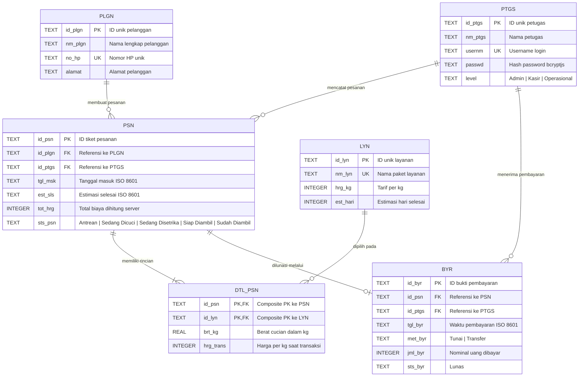
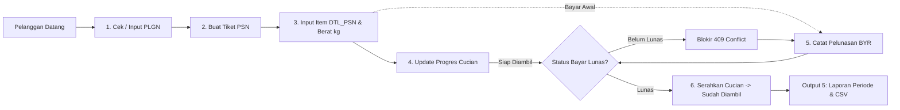

<div align="center">
  

  <h1>Sistem Pengelolaan Laundry (Qwash)</h1>
  <p>
    <strong>Realisasi Rancangan ERD Mata Kuliah Sistem Basis Data 1 (SBD 1) — Kelas 3IA01</strong><br />
    Aplikasi Web Operasional Laundry Full-Stack dengan Arsitektur Relasional Turso (libSQL), Drizzle ORM, Hono API, React + Tailwind CSS (Minimalism &amp; Swiss Style), dan PWA.
  </p>

  <p>
    <a href="https://sbd1-laundry.vercel.app"><strong>Live Production: sbd1-laundry.vercel.app</strong></a>
  </p>

  <!-- Tech Stack Badges -->
  <p>
    
    
    
    
    
    
  </p>
  <p>
    
    
    
    
    
    
  </p>
</div>

---

## Buat Apa Web Ini Dibuat?

Aplikasi web ini dibuat untuk **merealisasikan rancangan Entity Relationship Diagram (ERD)** dan perancangan sistem informasi yang telah disusun pada mata kuliah **Sistem Basis Data 1 (SBD 1)** menjadi perangkat lunak operasional nyata (*production-ready*).

Dalam operasional usaha laundry konvensional, pencatatan manual rentan terhadap kesalahan perhitungan harga kiloan, nota yang hilang, ketidaksinkronan status antara meja kasir dan area cuci-setrika, hingga risiko cucian diserahkan sebelum dibayar lunas. Web ini menyelesaikan masalah tersebut dengan:

1. **Merealisasikan 100% Skema ERD Proposal:** Seluruh nama tabel (`PLGN`, `PTGS`, `LYN`, `PSN`, `DTL_PSN`, `BYR`) beserta seluruh atribut, *Primary Key*, *Composite Primary Key*, dan *Foreign Key Constraints* (`PRAGMA foreign_keys = ON`) dipertahankan persis sesuai perancangan basis data SBD 1.
2. **Menjaga Integritas Transaksi:** Pembuatan tiket pesanan dan detail item dilakukan secara atomik menggunakan transaksi database, dengan perhitungan tarif total dan estimasi selesai dikunci di sisi server.
3. **Pelacakan Transparan (Internal & Pelanggan):** Petugas dapat memantau progres cucian berdasarkan hak akses peran (`Admin`, `Kasir`, `Operasional`), sementara pelanggan dapat melacak status cuciannya langsung melalui beranda publik tanpa perlu login.
4. **Dukungan Mobile & PWA:** Dapat langsung dipasang ke layar utama HP Android maupun iOS Safari sebagai aplikasi (*Progressive Web App*) serta mendukung cetak struk fisik (`window.print()`).

---

## Entity Relationship Diagram (ERD)

Berikut adalah diagram ERD relasional yang direalisasikan langsung pada [server/db/schema.sql](server/db/schema.sql) dan [server/db/schema.ts](server/db/schema.ts):



### Ringkasan 6 Entitas Basis Data

| Entitas | Nama Tabel | Kunci Utama (PK) | Kunci Asing (FK) & Constraint |
|---|---|---|---|
| **Pelanggan** | `PLGN` | `id_plgn` | `no_hp` bersifat `UNIQUE` |
| **Petugas** | `PTGS` | `id_ptgs` | `usernm` `UNIQUE`, `level` (`Admin`/`Kasir`/`Operasional`) |
| **Layanan** | `LYN` | `id_lyn` | `nm_lyn` `UNIQUE`, `hrg_kg > 0`, `est_hari >= 1` |
| **Pesanan** | `PSN` | `id_psn` | FK ke `PLGN` & `PTGS` (`ON DELETE RESTRICT`) |
| **Detail Pesanan** | `DTL_PSN` | Composite `(id_psn, id_lyn)` | FK ke `PSN` (`CASCADE`) & `LYN` (`RESTRICT`) |
| **Pembayaran** | `BYR` | `id_byr` | FK ke `PSN` & `PTGS` (`ON DELETE RESTRICT`) |

---

## Alur Bisnis, 5 Output & 6 Prosedur



### 5 Output Wajib Sistem
1. **Output 1 — Data Pelanggan (`PLGN`):** Daftar pelanggan terdaftar, kontak, alamat, serta pencarian nama/nomor HP.
2. **Output 2 — Data Layanan (`LYN`):** Katalog paket layanan cuci, tarif per kilogram, dan estimasi hari pengerjaan.
3. **Output 3 — Tiket Pesanan (`PSN` + `DTL_PSN`):** Rincian paket, berat kg, total tagihan otomatis, pelacakan publik mandiri, dan tampilan cetak nota (*print-friendly*).
4. **Output 4 — Bukti Pembayaran (`BYR`):** Struk resmi status `Lunas` (`Tunai` / `Transfer`).
5. **Output 5 — Laporan Transaksi:** Rekapitulasi omzet, filter rentang tanggal, tabel transaksi, dan ekspor CSV.

### 6 Prosedur Operasional
- **Prosedur 1:** Pendaftaran atau verifikasi pelanggan lama/baru.
- **Prosedur 2 & 3:** Pembuatan tiket pesanan multi-layanan dan penggabungan otomatis layanan duplikat agar sesuai Composite PK `(id_psn, id_lyn)`.
- **Prosedur 4:** Pembaruan status bertahap (`Antrean` -> `Sedang Dicuci` -> `Sedang Disetrika` -> `Siap Diambil`).
- **Prosedur 5:** Pencatatan pelunasan pembayaran di awal atau saat pengambilan.
- **Prosedur 6:** **Blokir mutlak pengambilan cucian sebelum lunas** (`409 Conflict`). Jika sudah lunas, status pesanan resmi ditutup menjadi `Sudah Diambil`.

---

## Arsitektur & Keamanan

- **Visual Theme (Minimalism & Swiss Style v2.0):** Palet *Deep Slate Navy* (`#0F172A`), *Ocean Action Blue* (`#0369A1`), kanvas dingin (`#F8FAFC`), border presisi `1px` (`#E2E8F0`), serta pasangan tipografi **`Fira Code`** (judul, ID tiket, nominal `tabular-nums`) dan **`Fira Sans`**.
- **Server-Side Pricing & Atomic Batch:** Seluruh kalkulasi harga `hrg_trans`, `tot_hrg`, dan estimasi `est_sls` dihitung di backend Hono menggunakan `db.batch([...], 'write')`.
- **Stateless Auth & Security Hardening:** Autentikasi JWT via `HttpOnly` cookie, *constant-time password check* menggunakan `bcryptjs`, proteksi *brute-force rate limiting*, dan pemblokiran eksposur kolom `PTGS.passwd` di seluruh endpoint.
- **Progressive Web App (PWA):** Dilengkapi `public/sw.js` (strategi *Network-Only* untuk `/api/*`) dan banner instalasi otomatis ketika dibuka melalui browser HP Android maupun iOS Safari.

---

## Panduan Menjalankan di Lokal (Local Development)

### 1. Prasyarat
- **Node.js** versi 18 ke atas (direkomendasikan Node.js 20+).
- **npm** (atau package manager kompatibel).

### 2. Instalasi Dependensi
```bash
npm install
```

### 3. Konfigurasi Environment Variable
Salin `.env.example` menjadi `.env.local` dan sesuaikan nilainya:
```env
TURSO_DATABASE_URL="file:local.db"
TURSO_AUTH_TOKEN=""
JWT_SECRET="ganti-dengan-random-secret-minimal-32-karakter"
PORT=3001
```

### 4. Inisialisasi Skema & Seeding Data Awal
```bash
# Terapkan skema Drizzle ke database (opsional jika menggunakan Turso CLI)
npm run db:push

# Isi akun staf default & contoh data layanan/pelanggan
npm run db:seed

# Buka visual Drizzle Studio (opsional)
npm run db:studio
```

### 5. Menjalankan Aplikasi & Build
```bash
# Jalankan frontend (port 3000) & backend API Hono (port 3001) bersamaan
npm run dev

# Build produksi & validasi TypeScript
npm run build
```

---

## Akun Demo Default (Hasil Seed)

Halaman `/login` menyediakan tombol *Quick Fill* untuk menguji masing-masing tingkat peran (`PTGS.level`):

| Username | Password | Peran (`level`) | Hak Akses |
|---|---|---|---|
| `admin` | `admin123` | **Admin** | Akses penuh seluruh menu, tarif layanan, laporan, dan kelola staf |
| `kasir` | `kasir123` | **Kasir** | Data pelanggan, buat pesanan, catat pembayaran, dan serah terima cucian |
| `operasional` | `opera123` | **Operasional** | Pantau antrean dan perbarui tahap pengerjaan cucian (`sts_psn`) |

---

## Panduan Deployment (Turso Cloud + Vercel)

1. **Buat & Terapkan Skema di Turso Cloud:**
   ```bash
   turso db create sistem-laundry
   turso db shell sistem-laundry < server/db/schema.sql
   ```
2. **Atur Environment Variables di Vercel (`Settings > Environment Variables`):**
   - `TURSO_DATABASE_URL` (`libsql://...`)
   - `TURSO_AUTH_TOKEN`
   - `JWT_SECRET` (`openssl rand -hex 32`)
3. **Deploy:** Push ke branch `main`. Konfigurasi [vercel.json](vercel.json) akan mengarahkan `/api/*` ke `api/index.ts` dan menyajikan SPA Vite beserta Service Worker PWA.

---

## Struktur Direktori

```text
├── api/
│   └── index.ts                  # Entrypoint Vercel Serverless Function (@hono/node-server/vercel)
├── docs/                         # Dokumen spesifikasi PRD, Design System v2.0, Spec & Guardrails
├── public/
│   ├── branding/kit/             # Master aset vektor & ikon PWA Qwash
│   ├── site.webmanifest          # Konfigurasi manifest Progressive Web App (PWA)
│   └── sw.js                     # Service Worker (Network-Only untuk /api/*, App Shell cache)
├── server/
│   ├── app.ts                    # Konfigurasi Hono app, security headers, CORS & router utama
│   ├── dev.ts                    # Local development server (@hono/node-server)
│   ├── db/
│   │   ├── client.ts             # Koneksi @libsql/client + customFetch serverless & Drizzle ORM
│   │   ├── schema.sql            # Skema DDL SQLite/Turso asli proposal
│   │   ├── schema.ts             # Definisi tabel relasional Drizzle ORM
│   │   └── seed.ts               # Skrip pengisian data awal (PTGS, LYN, PLGN)
│   ├── middleware/
│   │   ├── auth.ts               # Verifikasi JWT HttpOnly cookie & role guard
│   │   └── rateLimit.ts          # Rate limiter anti brute-force login & pelacakan publik
│   └── routes/                   # auth, bayar, laporan, layanan, pelanggan, pesanan, petugas
├── shared/
│   └── schemas.ts                # Skema validasi Zod & TypeScript types bersama (FE + BE)
├── src/
│   ├── components/
│   │   ├── laundry/              # OrderStepper, PrintTicketView, StatusBadge, PwaInstallPrompt, dll.
│   │   ├── layout/               # AppShell (navigasi responsif print:hidden) & ErrorBoundary
│   │   └── ui/                   # Komponen primitif shadcn/ui
│   ├── hooks/
│   │   └── useAuth.tsx           # Context & hook manajemen sesi autentikasi staf
│   ├── lib/                      # api.ts, format.ts, utils.ts
│   ├── pages/                    # LandingPage, LoginPage, OrdersPage, CreateOrderPage, OrderDetailPage, dll.
│   ├── App.tsx                   # Konfigurasi routing & proteksi peran
│   ├── index.css                 # Base styles, focus ring a11y, mobile-native & print CSS
│   └── main.tsx                  # Entrypoint React & registrasi Service Worker PWA
├── drizzle.config.ts             # Konfigurasi Drizzle Kit
├── tailwind.config.ts            # Token tema Minimalism & Swiss Style (v2.0)
└── vercel.json                   # Konfigurasi header Service Worker & rewrite routing Vercel
```
