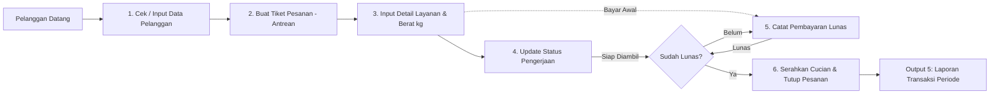

# PRD — Sistem Pengelolaan Laundry

- **Versi:** 1.1
- **Tanggal:** 2026-11-20
- **Status:** Approved (Gate 2)
- **Sumber input:** PDF *Perancangan Sistem Basis Data Pengelolaan Laundry Berbasis Web Menggunakan PostgreSQL* (ERD, Keterangan 6 Entitas, 5 Output, 6 Prosedur) & keputusan Gate 2 user.
- **Skill digunakan:** `prd-writer` *(via orchestrator `pm-flow`, fast-track melewati Tahap 0–2 atas permintaan user)*

## TL;DR

Aplikasi web Sistem Pengelolaan Laundry ini merealisasikan rancangan ERD tugas kuliah Sistem Basis Data (6 tabel utama: `PLGN`, `PTGS`, `LYN`, `PSN`, `DTL_PSN`, `BYR`) menjadi sistem operasional kasir dan pengerjaan laundry yang utuh. Petugas dapat mencatat pelanggan baru/lama, membuat tiket pesanan dengan rincian layanan dan hitung harga otomatis, memperbarui status pengerjaan secara bertahap (`Antrean` → `Sedang Dicuci` → `Sedang Disetrika` → `Siap Diambil`), mencatat pembayaran `Lunas` (di awal atau akhir), memblokir pengambilan cucian yang belum lunas, serta menarik laporan transaksi per periode.

## 1. Problem Statement

`[ASUMSI]` Pengelolaan operasional laundry yang masih mengandalkan pencatatan manual rentan mengalami kesalahan perhitungan tarif per layanan, kehilangan data pelanggan/nota pesanan, ketidaksinkronan status cucian antara kasir dan petugas cuci/setrika, hingga risiko cucian diserahkan sebelum pembayaran lunas, serta sulitnya merekap pendapatan per periode secara cepat.

Pada konteks tugas mata kuliah Sistem Basis Data, dibutuhkan realisasi aplikasi web yang memetakan secara akurat 6 entitas ERD beserta relasi, 6 prosedur operasional, dan 5 output sistem agar integritas data transaksi terjaga dari hulu ke hilir.

**Framing Jobs-to-be-Done (JTBD):** `[ASUMSI]`
- **Core Job (Petugas Kasir):** *When* pelanggan datang menaruh atau mengambil cucian, *I want to* mencatat data pelanggan, rincian berat layanan, status bayar, dan serah terima dalam satu alur cepat, *so I can* menghitung total biaya tanpa salah dan memastikan tidak ada cucian keluar sebelum lunas.
- **Dimensi Job:**
  - *Functional:* Pendataan pelanggan, kalkulasi otomatis harga × berat, tracking status bertahap, validasi pelunasan, dan rekap laporan periode.
  - *Emotional:* Tenang dan percaya diri saat serah terima cucian maupun saat tutup kasir/rekap omzet.
  - *Social:* Terlihat profesional dan tertib di mata pelanggan (ada tiket pesanan & bukti pembayaran yang jelas).

## 2. Goals

- Merealisasikan seluruh 6 entitas ERD (`PLGN`, `PTGS`, `LYN`, `PSN`, `DTL_PSN`, `BYR`) beserta integritas relasinya ke dalam aplikasi web fungsional.
- Mendigitalkan 6 prosedur operasional laundry secara *end-to-end*: pendataan pelanggan, pembuatan tiket, pencatatan detail cucian, pembaruan status bertahap, pembayaran, dan validasi pengambilan cucian.
- Menghasilkan 5 output wajib sistem: Data Pelanggan, Data Layanan, Tiket Pesanan, Bukti Pembayaran, dan Laporan Transaksi berdasarkan periode tertentu.

## 3. Target Users

### Petugas Kasir (`PTGS`)

**Description:** Petugas yang berjaga di meja depan (*front-desk*) dan melakukan login ke sistem.

**Need:** Mengecek/mendaftarkan pelanggan, membuat tiket pesanan, memasukkan layanan & berat/kuantitas cucian dengan total harga otomatis, mencatat pembayaran (awal/akhir), memvalidasi pelunasan saat pengambilan, serta mencetak/melihat bukti pembayaran.

**Context:** Berinteraksi langsung dengan pelanggan saat cucian masuk dan saat cucian diambil.

### Petugas Operasional (`PTGS`)

**Description:** Petugas yang menangani proses pencucian, pengeringan, dan penyetrikaan.

**Need:** Melihat daftar antrean cucian aktif dan memperbarui status pengerjaan pesanan secara bertahap hingga siap diambil.

**Context:** Bekerja di area produksi/cuci; membutuhkan pembaruan status cepat agar kasir tahu pesanan mana yang sudah siap diserahkan ke pelanggan. `[ASUMSI]` Di laundry skala kecil, akun kasir dan operasional bisa dipegang orang yang berbeda (lewat atribut `level`) atau orang yang sama.

### Admin / Pengelola Laundry (`PTGS`)

**Description:** `[ASUMSI]` Petugas dengan `level` tertinggi (pemilik/admin) yang mengelola master data dan laporan.

**Need:** Mengelola daftar master layanan (`LYN`) beserta tarif dan estimasi hari, mengelola akun petugas (`PTGS`), serta memantau Laporan Transaksi & pendapatan berdasarkan rentang periode tertentu.

**Context:** Memastikan tarif layanan mutakhir dan mengevaluasi performa pendapatan laundry secara berkala.

## 4. User Stories

- As a petugas kasir, I want to mencari pelanggan berdasarkan nama atau nomor HP dan mendaftarkan pelanggan baru jika belum ada, so that saya tidak menginput ulang data pelanggan lama dan tidak terjadi duplikasi data.
- As a petugas kasir, I want to membuat tiket pesanan baru dengan memilih layanan dari daftar master lalu mengisi berat/kuantitas cucian, so that estimasi tanggal selesai dan total harga terhitung otomatis tanpa salah hitung manual.
- As a petugas operasional, I want to memperbarui status pesanan secara bertahap (`Antrean` → `Sedang Dicuci` → `Sedang Disetrika` → `Siap Diambil`), so that tim kasir mengetahui progres real-time tiap pesanan.
- As a petugas kasir, I want to mencatat pembayaran (tunai atau transfer) baik di awal saat menaruh cucian maupun di akhir saat pengambilan, so that status pembayaran tercatat sebagai `Lunas` dan bukti pembayaran dapat diterbitkan.
- As a petugas kasir, I want to memverifikasi bahwa pembayaran sudah `Lunas` sebelum menyerahkan cucian dan menutup transaksi, so that tidak ada cucian yang keluar tanpa dibayar.
- As a admin/pengelola, I want to mengelola data master layanan, data petugas, dan melihat laporan rekapitulasi transaksi serta total pendapatan pada rentang tanggal tertentu, so that operasional dan keuangan laundry terkontrol dengan akurat.

## 5. Functional Requirements

### FR-01 — Autentikasi & Manajemen Petugas (`PTGS`)

**Requirement:** Sistem MUST mewajibkan petugas untuk login menggunakan `usernm` dan `passwd` sebelum mengakses fitur operasional apa pun. Sistem MUST menyimpan identitas petugas yang login (`id_ptgs`) untuk ditautkan pada pembuatan pesanan (`PSN`) dan pencatatan pembayaran (`BYR`), serta mendukung pengelolaan akun petugas berdasarkan `level`.

**Acceptance Criteria:**
- Pengunjung yang belum login dialihkan ke halaman login dan seluruh endpoint API operasional (selain login) menolak akses tanpa sesi valid.
- Saat login berhasil, sistem mengenali `id_ptgs`, `nm_ptgs`, dan `level` petugas yang sedang aktif.
- `[ASUMSI]` Petugas dengan `level` Admin dapat menambah/mengubah data petugas (`nm_ptgs`, `usernm`, `passwd`, `level`).

**Related User Story:** User Story 6.

---

### FR-02 — Pencarian & Pendataan Pelanggan (`PLGN` — Prosedur 1 & Output 1)

**Requirement:** Sistem MUST menyediakan daftar Data Pelanggan (`id_plgn`, `nm_plgn`, `no_hp`, `alamat`), fitur pencarian cepat (minimal berdasarkan nama atau `no_hp`), serta form pendaftaran pelanggan baru dan pembaruan data pelanggan.

**Acceptance Criteria:**
- Petugas dapat mencari pelanggan yang sudah terdaftar sebelum membuat pesanan baru.
- Input pelanggan baru mewajibkan `nm_plgn` dan `no_hp` (dengan `alamat` wajib/tervalidasi sesuai kebutuhan form), dan `id_plgn` ter-generate unik.
- Halaman Data Pelanggan menampilkan seluruh daftar pelanggan terdaftar beserta informasi kontaknya (Output 1).

**Related User Story:** User Story 1.

---

### FR-03 — Pengelolaan Master Layanan (`LYN` — Output 2)

**Requirement:** Sistem MUST menyediakan pengelolaan daftar Data Layanan (`id_lyn`, `nm_lyn`, `hrg_kg`, `est_hari`) mencakup lihat daftar, tambah layanan baru, dan ubah tarif/estimasi layanan.

**Acceptance Criteria:**
- Halaman Data Layanan menampilkan nama layanan, harga per kg/unit, dan estimasi hari pengerjaan (Output 2).
- Perubahan harga pada master `LYN` hanya berlaku untuk pesanan baru dan MUST NOT mengubah `hrg_trans` maupun `tot_hrg` pada pesanan yang sudah tercatat sebelumnya.

**Related User Story:** User Story 2, 6.

---

### FR-04 — Pembuatan Tiket Pesanan & Detail Cucian (`PSN` & `DTL_PSN` — Prosedur 2, 3 & Output 3)

**Requirement:** Sistem MUST memungkinkan petugas membuat tiket pesanan baru yang tertaut ke satu pelanggan (`id_plgn`) dan petugas pembuat (`id_ptgs`), mencatat tanggal masuk (`tgl_msk`) otomatis, memilih satu atau lebih layanan beserta berat/kuantitas (`brt_kg`) ke dalam `DTL_PSN`, membekukan harga saat transaksi (`hrg_trans`), menghitung estimasi selesai (`est_sls`) dan total harga (`tot_hrg`) secara otomatis, serta menetapkan status awal pesanan menjadi `Antrean`.

**Acceptance Criteria:**
- Satu tiket pesanan (`PSN`) dapat memuat satu atau lebih baris detail layanan (`DTL_PSN`).
- Sistem otomatis mengisi `tgl_msk` saat transaksi dibuat, menghitung `est_sls` berdasarkan `est_hari` layanan (`[ASUMSI]` mengambil `est_hari` terpanjang jika dalam satu pesanan ada lebih dari satu jenis layanan), dan menghitung `tot_hrg = SUM(brt_kg * hrg_trans)`.
- `hrg_trans` diisi otomatis dari `LYN.hrg_kg` saat transaksi dibuat (server-side calculation untuk mencegah manipulasi harga).
- Sistem menampilkan tampilan **Tiket Pesanan** (Output 3) berisi ID pesanan, nama pelanggan, rincian layanan & berat, total harga, tanggal masuk, estimasi selesai, dan status pengerjaan.

**Related User Story:** User Story 2.

---

### FR-05 — Pembaruan Status Pengerjaan Bertahap (`PSN` — Prosedur 4)

**Requirement:** Sistem MUST memungkinkan petugas memperbarui `sts_psn` secara bertahap mengikuti alur siklus pengerjaan: `Antrean` → `Sedang Dicuci` → `Sedang Disetrika` → `Siap Diambil` (dan berlanjut ke `Sudah Diambil` saat serah terima di `FR-07`).

**Acceptance Criteria:**
- Daftar pesanan menampilkan status terkini dengan indikator visual yang jelas (misal badge status) dan filter berdasarkan status.
- Transisi status mengikuti urutan alur yang valid (`Antrean` → `Sedang Dicuci` → `Sedang Disetrika` → `Siap Diambil`, lalu `Sudah Diambil` via aksi pengambilan di `FR-07`), sehingga mencegah status melompat secara tidak sengaja (`[ASUMSI]` opsi koreksi/undo hanya diizinkan dengan konfirmasi eksplisit atau oleh Admin).

**Related User Story:** User Story 3.

---

### FR-06 — Pencatatan Pembayaran & Bukti Pembayaran (`BYR` — Prosedur 5 & Output 4)

**Requirement:** Sistem MUST mendukung pencatatan pembayaran (`id_byr`, `id_psn`, `id_ptgs`, `tgl_byr`, `met_byr`, `jml_byr`, `sts_byr`) baik dilakukan di awal (saat pesanan dibuat) maupun di akhir (saat pengambilan cucian), dengan pilihan metode pembayaran minimal `Tunai` dan `Transfer`.

**Acceptance Criteria:**
- Saat pembayaran dicatat dengan nominal minimal sama dengan `PSN.tot_hrg`, `sts_byr` otomatis ditetapkan menjadi `Lunas`, `tgl_byr` tercatat, dan `id_ptgs` petugas penerima bayar tersimpan.
- Sistem menolak pencatatan pembayaran ganda jika pesanan tersebut sudah berstatus `Lunas`, serta menolak nominal pembayaran yang kurang dari `tot_hrg` (`[ASUMSI]` pembayaran penuh sekali bayar untuk MVP).
- Sistem menyediakan tampilan **Bukti Pembayaran** (Output 4) berisi detail pesanan, jumlah bayar, metode (`Tunai`/`Transfer`), tanggal bayar, petugas kasir, dan status `Lunas`.

**Related User Story:** User Story 4.

---

### FR-07 — Validasi Pengambilan Cucian & Penutupan Transaksi (`PSN` — Prosedur 6)

**Requirement:** Sistem MUST memvalidasi bahwa pesanan telah memiliki pembayaran berstatus `Lunas` sebelum petugas dapat menandai cucian telah diambil oleh pelanggan dan menutup siklus transaksi pesanan.

**Acceptance Criteria:**
- Jika pesanan belum berstatus bayar `Lunas`, tombol/aksi **"Serahkan / Ambil Cucian"** diblokir dan sistem menampilkan peringatan jelas untuk memproses pembayaran terlebih dahulu (`FR-06`).
- Jika pesanan sudah `Lunas` (dan status pengerjaan sudah `Siap Diambil`), petugas dapat menyelesaikan pengambilan cucian dan sistem memperbarui `sts_psn` menjadi `Sudah Diambil` untuk menutup siklus transaksi pesanan sesuai Prosedur 6 (tetap mempertahankan field tabel `PSN` persis sesuai proposal tanpa mengubah/menambah nama field).

**Related User Story:** User Story 5.

---

### FR-08 — Laporan Transaksi & Rekapitulasi Pendapatan (`PSN` & `BYR` — Output 5)

**Requirement:** Sistem MUST menyediakan halaman Laporan Transaksi yang menampilkan rekapitulasi jumlah transaksi, total pendapatan, dan rincian daftar transaksi berdasarkan filter rentang tanggal (periode tertentu).

**Acceptance Criteria:**
- Pengguna dapat memilih rentang tanggal awal dan tanggal akhir (`start_date` – `end_date`).
- Laporan menampilkan metrik ringkas (total transaksi masuk, total transaksi lunas, total pendapatan pada periode terpilih) dan tabel rincian transaksi (`id_psn`, tanggal, pelanggan, total harga, metode bayar, status bayar, status pengerjaan).
- Nominal total pendapatan hanya menghitung transaksi yang sudah memiliki catatan pembayaran `Lunas` pada periode tersebut.

**Related User Story:** User Story 6.

## 6. Non-Functional Requirements

### NFR-01 — Security & Access Control
- Password petugas (`PTGS.passwd`) MUST disimpan dalam bentuk hash yang aman (misal bcrypt/argon2/scrypt), bukan plaintext.
- Kalkulasi total harga (`tot_hrg`), penguncian harga transaksi (`hrg_trans`), dan validasi pelunasan sebelum pengambilan cucian MUST dijalankan di sisi server (backend API), bukan hanya validasi UI.

### NFR-02 — Data Integrity & Consistency
- Relasi antar tabel (`PLGN`, `PTGS`, `LYN`, `PSN`, `DTL_PSN`, `BYR`) MUST dijaga dengan *foreign key constraints* dan transaksi database atomik (misal pembuatan `PSN` beserta baris `DTL_PSN` harus berhasil semua atau rollback semua jika gagal).
- Penghapusan data master (`PLGN`, `LYN`, `PTGS`) yang sudah terikat pada histori transaksi MUST dicegah (*restrict*) agar histori laporan tidak rusak.

### NFR-03 — Usability & Compatibility
- Antarmuka web MUST responsif dan nyaman digunakan di browser desktop modern (skenario kasir meja depan) maupun tablet/ponsel (skenario petugas operasional memperbarui status cucian).
- Target metrik latensi/kapasitas spesifik: **TBD**.

## 7. Scope

### In Scope

**Must Have (Wajib untuk memenuhi ERD, 6 Prosedur, & 5 Output):**
- Login & manajemen sesi petugas (`PTGS`).
- CRUD Data Pelanggan & pencarian cepat (`PLGN` — Output 1, Prosedur 1).
- CRUD Master Data Layanan (`LYN` — Output 2).
- Pembuatan Tiket Pesanan + multi-item Detail Pesanan + kalkulasi otomatis harga & estimasi selesai (`PSN`, `DTL_PSN` — Output 3, Prosedur 2 & 3).
- Pembaruan status pengerjaan bertahap (`Antrean` → `Sedang Dicuci` → `Sedang Disetrika` → `Siap Diambil` — Prosedur 4).
- Pencatatan pembayaran (`Tunai`/`Transfer`, awal/akhir) & tampilan Bukti Pembayaran (`BYR` — Output 4, Prosedur 5).
- Validasi wajib `Lunas` saat pengambilan cucian & penutupan transaksi (Prosedur 6).
- Laporan Transaksi & rekapitulasi pendapatan dengan filter periode tanggal (Output 5).
- Kepatuhan skema database 100% mempertahankan nama tabel (`PLGN`, `PTGS`, `LYN`, `PSN`, `DTL_PSN`, `BYR`) dan nama field persis sesuai keterangan & ERD proposal tanpa diubah.

**Should Have (Nilai tambah tinggi dengan effort rendah):**
- Halaman/tampilan cetak (*print-friendly*) untuk Tiket Pesanan dan Bukti Pembayaran (`window.print()`).
- Dashboard ringkas status cucian hari ini (jumlah per status: Antrean, Dicuci, Disetrika, Siap Diambil, Sudah Diambil, Belum Lunas).

**Could Have (Opsional jika waktu cukup):**
- Ekspor Laporan Transaksi ke format CSV.

### Out of Scope

- Portal login mandiri untuk pelanggan atau halaman tracking resi publik tanpa login.
- Integrasi *payment gateway* otomatis (QRIS dinamis, Virtual Account, Midtrans/Xendit webhook).
- Notifikasi WhatsApp/SMS/Email otomatis ke pelanggan saat cucian selesai.
- Manajemen stok bahan baku (deterjen, pewangi, plastik) dan pengeluaran operasional/beban gaji.
- Dukungan multi-cabang (*multi-outlet*) atau manajemen diskon/promo/poin loyalitas.
- Skema pembayaran cicilan/DP parsial.

## 8. Asumsi, Risiko, dan Pertanyaan Terbuka

- `[RISIKO]` **Kesesuaian DBMS dengan Judul Dokumen:** Judul PDF tugas tertulis *"MENGGUNAKAN PostgreSQL"*, namun di Gate 2 user memutuskan tetap memakai **Vite + React + Hono + Turso (libSQL/SQLite)** agar sesuai eksplorasi stack tim. Catatan risiko: pastikan di laporan/presentasi ke dosen tetap dijelaskan kesetaraan skema relasionalnya.
- **Keputusan Penyelarasan Proposal (Gate 2):**
  1. **Nama Tabel & Field Tetap Asli Proposal:** Seluruh skema menggunakan `PLGN`, `PTGS`, `LYN`, `PSN`, `DTL_PSN` (mengacu ke Keterangan no. 5; di diagram tertulis `DTK_PSN`), dan `BYR` dengan nama field persis dari Keterangan & diagram ERD (`BYR.id_ptgs` dipertahankan karena tergambar di relasi `dilakukan oleh`).
  2. **Penutupan Prosedur 6 tanpa ubah kolom:** Karena ERD `PSN` tidak memiliki kolom `tgl_kembali`, penutupan siklus pengambilan cucian dilakukan dengan mengubah `PSN.sts_psn` menjadi `Sudah Diambil` setelah validasi `BYR.sts_byr = 'Lunas'`.
  3. **Kardinalitas `DTL_PSN`:** Di gambar ERD tertulis `PSN 1:1 DTK_PSN`, namun diimplementasikan secara logis sebagai `PSN 1:N DTL_PSN` (sesuai Prosedur 3 multi-layanan) dengan composite primary key `(id_psn, id_lyn)` tanpa menambah kolom PK baru; jika layanan sama dipilih ulang pada satu pesanan, kuantitas `brt_kg` digabung.
- `[ASUMSI]` **Pembagian Hak Akses `PTGS.level`:** Nilai `level` mencakup `Admin` (kelola master `LYN`, `PTGS`, & laporan), `Kasir` (pelanggan, pesanan, pembayaran, pengambilan), dan `Operasional` (update status cucian) mengikuti narasi Prosedur 1 & 4; `Admin` juga memiliki akses penuh untuk keperluan demo tugas kuliah.
- `[ASUMSI]` Pembayaran menggunakan skema langsung lunas (`1x bayar`, di awal atau di akhir) sesuai narasi Prosedur 5, belum memakai DP/cicilan bertahap.
- `[ASUMSI]` Satuan `brt_kg` pada `DTL_PSN` mendukung angka desimal (misal `2.5` kg) maupun bilangan bulat (untuk layanan per pcs seperti selimut sesuai narasi Prosedur 3).

## Changelog

| Versi | Tanggal | Perubahan |
|---|---|---|
| 1.0 | 2026-11-20 | Draft awal PRD (`04-prd.md`) dari dokumen ERD, 5 Output, dan 6 Prosedur tugas kuliah Sistem Basis Data (mode fast-track melewati Tahap 0–2). |
| 1.1 | 2026-11-20 | **Gate 2 Approved:** Mengunci tech stack `Vite + React + Hono + Turso` dan mengunci kepatuhan nama tabel & field 100% sesuai proposal tanpa mengubah/menambah kolom di luar ERD; penutupan Prosedur 6 ditangani lewat `sts_psn = 'Sudah Diambil'`. |
