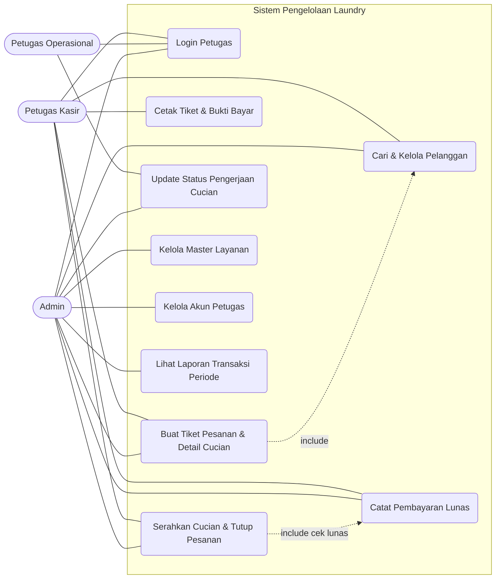
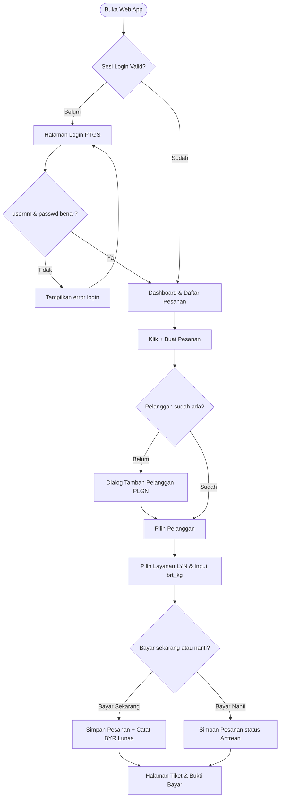
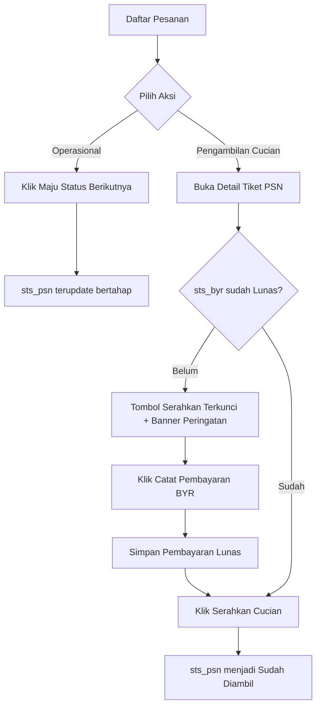
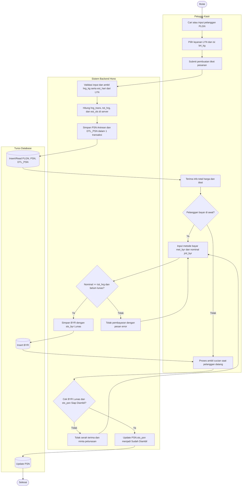
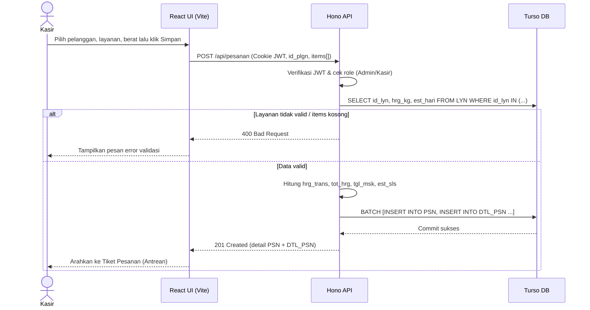
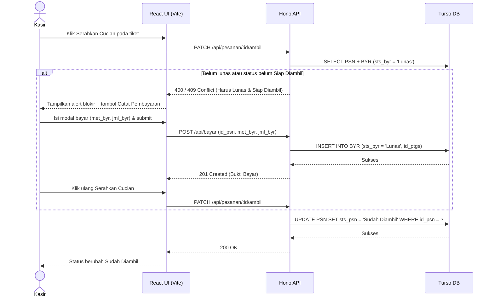
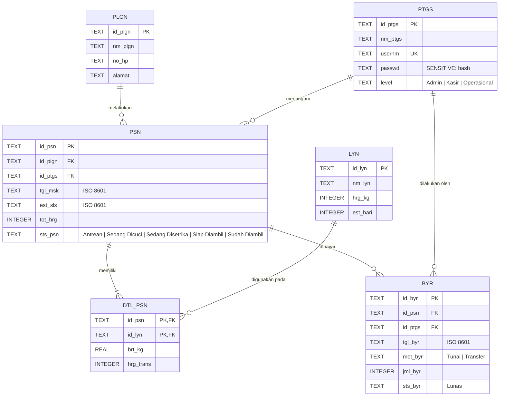
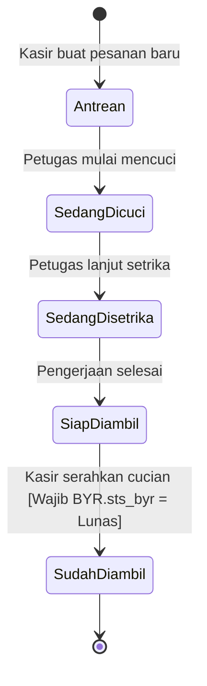
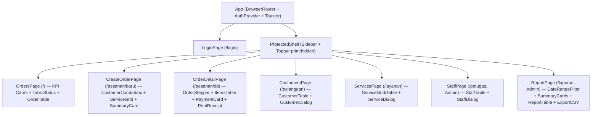

# Spec Teknis: Sistem Pengelolaan Laundry

- **Versi:** 1.3
- **Tanggal:** 2026-11-27
- **Status:** Approved (Gate 3)
- **Sumber input:** `04-prd.md` v1.1 (Approved), `05-design.md` v2.3, `project-context.md`, dan dokumen ERD Proposal Tugas Kuliah Sistem Basis Data.
- **Skill digunakan:** `spec-writer`

## TL;DR

Dokumen ini menerjemahkan `04-prd.md` v1.1 dan `05-design.md` v1.0 menjadi spesifikasi teknis siap implementasi (*vibecoding*) menggunakan stack **Vite + React + `shadcn/ui` + Hono + Turso (libSQL)** dengan deployment di **Vercel**.

Seluruh skema basis data mempertahankan **100% nama tabel dan nama field asli proposal** (`PLGN`, `PTGS`, `LYN`, `PSN`, `DTL_PSN`, `BYR`) tanpa penambahan atau perubahan nama kolom. Bagian paling kritis yang dijaga di backend Hono adalah transaksi atomik pembuatan tiket (`PSN` + `DTL_PSN`), penguncian harga `hrg_trans` di server, autentikasi stateless via JWT *HttpOnly cookie* untuk Vercel Serverless, serta blokir mutlak pengambilan cucian jika `BYR.sts_byr` belum `Lunas`.

---

## 1. Ringkasan

- **Tujuan produk:** Aplikasi web operasional internal laundry yang merealisasikan 6 entitas ERD, 6 prosedur operasional, dan 5 output sistem tugas kuliah Sistem Basis Data.
- **Fitur MVP yang dicover:**
  - Login & sesi petugas (`PTGS`) berbasis role `Admin`, `Kasir`, `Operasional`.
  - Pendataan & pencarian cepat pelanggan (`PLGN` — Output 1, Prosedur 1).
  - Pengelolaan master layanan (`LYN` — Output 2).
  - Pembuatan tiket pesanan + multi-layanan + hitung otomatis `est_sls`, `hrg_trans`, `tot_hrg` (`PSN` & `DTL_PSN` — Output 3, Prosedur 2 & 3).
  - Pembaruan status cucian bertahap (`sts_psn` — Prosedur 4).
  - Pencatatan pembayaran (`Tunai`/`Transfer`) & cetak bukti bayar (`BYR` — Output 4, Prosedur 5).
  - Validasi wajib `Lunas` saat pengambilan cucian & penutupan transaksi (`sts_psn = 'Sudah Diambil'` — Prosedur 6).
  - Laporan transaksi & rekapitulasi pendapatan per rentang tanggal + opsional ekspor CSV (Output 5).
- **Tech stack (Dikunci):**
  - **Frontend:** Vite + React (TypeScript) + Tailwind CSS + `shadcn/ui` + `lucide-react` + `react-router-dom` + `gsap` (`@gsap/react`).
  - **Backend API:** Hono (TypeScript) berjalan sebagai Vercel Serverless Function (`api/index.ts` via `hono/vercel`).
  - **Database:** Turso / libSQL (`@libsql/client`) dengan SQLite relational schema + `PRAGMA foreign_keys = ON`.
  - **Deployment:** Vercel (single project: static SPA Vite di `dist/` + serverless API di `/api/*`).

---

## 2. Aktor

| Aktor | Nilai `PTGS.level` | Deskripsi | Hak Akses Utama |
|---|---|---|---|
| **Admin** | `Admin` | Pengelola / pemilik laundry (juga *super-user* untuk demo tugas kuliah). | Seluruh fitur: kelola `PTGS`, kelola `LYN`, kelola `PLGN`, buat/kelola `PSN`, catat `BYR`, serah terima cucian, lihat/ekspor Laporan Transaksi. |
| **Petugas Kasir** | `Kasir` | Petugas meja depan (*front-desk*). | Kelola `PLGN`, lihat `LYN`, buat `PSN` & `DTL_PSN`, catat `BYR`, serah terima cucian (`Sudah Diambil`), cetak tiket & bukti bayar. |
| **Petugas Operasional** | `Operasional` | Petugas pencucian & penyetrikaan. | Lihat daftar `PSN` & detail `DTL_PSN`, ubah `sts_psn` (`Antrean` → `Sedang Dicuci` → `Sedang Disetrika` → `Siap Diambil`). |

`[ASUMSI]` Untuk kelancaran operasional toko kecil maupun presentasi demo tugas kuliah, `Admin` dapat mengakses seluruh alur kasir dan operasional sekaligus.

---

## 3. Use Case Diagram (User Diagram)



| ID | Use Case | Aktor | Prasyarat | Hasil | Prioritas |
|---|---|---|---|---|---|
| UC1 | Login Petugas | Kasir, Operasional, Admin | Akun `PTGS` terdaftar | Cookie sesi JWT aktif | Must |
| UC2 | Cari & Kelola Pelanggan | Kasir, Admin | Sudah login | Data `PLGN` tampil / tersimpan (Output 1) | Must |
| UC3 | Buat Tiket Pesanan & Detail | Kasir, Admin | Pelanggan & Layanan ada | Record `PSN` (`Antrean`) + `DTL_PSN` tersimpan, `tot_hrg` & `est_sls` terhitung (Output 3) | Must |
| UC4 | Catat Pembayaran Lunas | Kasir, Admin | `PSN` ada & belum lunas | Record `BYR` dengan `sts_byr = 'Lunas'` tersimpan | Must |
| UC5 | Cetak Tiket & Bukti Bayar | Kasir, Admin | `PSN` (dan `BYR`) ada | Tampilan struk siap cetak (`window.print()`, Output 3 & 4) | Should |
| UC6 | Serahkan Cucian & Tutup | Kasir, Admin | `sts_psn = 'Siap Diambil'` & `sts_byr = 'Lunas'` | `PSN.sts_psn` berubah menjadi `Sudah Diambil` (Prosedur 6) | Must |
| UC7 | Update Status Pengerjaan | Operasional, Admin | `PSN` ada | `PSN.sts_psn` maju bertahap hingga `Siap Diambil` (Prosedur 4) | Must |
| UC8 | Kelola Master Layanan | Admin (Lihat: semua) | Login `Admin` untuk ubah | Data `LYN` terbaru tersimpan (Output 2) | Must |
| UC9 | Kelola Akun Petugas | Admin | Login `Admin` | Akun `PTGS` baru/update tersimpan dengan password ter-hash | Must |
| UC10 | Lihat Laporan Transaksi | Admin | Login `Admin` | Rekap jumlah order, total pendapatan lunas, & tabel per periode (Output 5) | Must |

---

## 4. User Flow

### Flow A — Alur Kasir: Penerimaan Cucian sampai Serah Terima



### Flow B — Alur Pengambilan Cucian & Update Status



---

## 5. Activity Diagram

Proses inti: **Pembuatan Tiket Pesanan, Pembayaran (Awal/Akhir), dan Validasi Pengambilan Cucian**.



**Aturan Bisnis yang Muncul:**
1. Harga saat transaksi (`DTL_PSN.hrg_trans`) dan total tagihan (`PSN.tot_hrg`) **wajib dihitung oleh backend Hono** berdasarkan data terbaru dari tabel `LYN`, bukan mempercayai nominal dari client.
2. Pembuatan baris `PSN` dan seluruh baris `DTL_PSN` wajib dibungkus dalam **satu transaksi database atomik** (`db.batch` / `transaction('write')`).
3. Jika dalam satu pesanan dipilih layanan yang sama lebih dari sekali di UI, frontend/backend menggabungkan (`sum`) `brt_kg`-nya menjadi satu baris `(id_psn, id_lyn)` agar sesuai *composite primary key* `DTL_PSN`.
4. Pesanan tidak dapat diubah ke `Sudah Diambil` jika belum ada baris di `BYR` dengan `sts_byr = 'Lunas'`.

---

## 6. Sequence Diagram

### Sequence 1 — Pembuatan Tiket Pesanan (`POST /api/pesanan`)



### Sequence 2 — Pembayaran & Serah Terima Cucian (`POST /api/bayar` & `PATCH /api/pesanan/:id/ambil`)



---

## 7. Data Model (100% Sesuai Proposal ERD)

> **Aturan Keras Skema:** Nama seluruh tabel (`PLGN`, `PTGS`, `LYN`, `PSN`, `DTL_PSN`, `BYR`) dan nama seluruh kolom wajib mengikuti rancangan proposal/keterangan ERD tanpa diubah atau ditambah kolom baru. Di gambar ERD terdapat label `DTK_PSN`, `hrg`, dan `mtd_byr`, namun spesifikasi menggunakan penamaan resmi pada daftar Keterangan proposal (`DTL_PSN`, `hrg_kg`, `met_byr`) serta menyertakan `BYR.id_ptgs` dari relasi `dilakukan oleh` pada diagram ERD.



### Detail Tabel & Constraint (Turso / SQLite)

1. **`PLGN` (Pelanggan)**
   | Field | Tipe Turso | Constraint | Catatan |
   |---|---|---|---|
   | `id_plgn` | `TEXT` | `PRIMARY KEY` | Format misal `PLG-0001` atau NanoID/UUID pendek (`[ASUMSI]`). |
   | `nm_plgn` | `TEXT` | `NOT NULL` | Di-index untuk pencarian cepat (`IDX_PLGN_NM`). |
   | `no_hp` | `TEXT` | `NOT NULL, UNIQUE` | Di-index; mencegah duplikasi pelanggan dengan nomor HP sama. |
   | `alamat` | `TEXT` | `NOT NULL` | Alamat pelanggan. |

2. **`PTGS` (Petugas)**
   | Field | Tipe Turso | Constraint | Catatan |
   |---|---|---|---|
   | `id_ptgs` | `TEXT` | `PRIMARY KEY` | ID unik petugas. |
   | `nm_ptgs` | `TEXT` | `NOT NULL` | Nama lengkap petugas. |
   | `usernm` | `TEXT` | `NOT NULL, UNIQUE` | Username login; terindeks unik. |
   | `passwd` | `TEXT` | `NOT NULL` | **Sensitif:** Wajib disimpan sebagai hash (`bcryptjs`/`scrypt`), **tidak boleh dikembalikan di API response**. |
   | `level` | `TEXT` | `NOT NULL, CHECK (level IN ('Admin', 'Kasir', 'Operasional'))` | Role akses petugas. |

3. **`LYN` (Layanan)**
   | Field | Tipe Turso | Constraint | Catatan |
   |---|---|---|---|
   | `id_lyn` | `TEXT` | `PRIMARY KEY` | ID unik layanan. |
   | `nm_lyn` | `TEXT` | `NOT NULL, UNIQUE` | Nama layanan (misal: *Cuci Kering Kiloan*, *Cuci Selimut*). |
   | `hrg_kg` | `INTEGER` | `NOT NULL, CHECK (hrg_kg > 0)` | Harga dalam Rupiah (bilangan bulat IDR). |
   | `est_hari` | `INTEGER` | `NOT NULL, CHECK (est_hari >= 1)` | Estimasi lama pengerjaan (hari). |

4. **`PSN` (Pesanan)**
   | Field | Tipe Turso | Constraint | Catatan |
   |---|---|---|---|
   | `id_psn` | `TEXT` | `PRIMARY KEY` | ID tiket pesanan (misal `PSN-20261120-001` agar mudah dibaca di nota). |
   | `id_plgn` | `TEXT` | `NOT NULL, REFERENCES PLGN(id_plgn) ON DELETE RESTRICT` | Di-index (`IDX_PSN_PLGN`). |
   | `id_ptgs` | `TEXT` | `NOT NULL, REFERENCES PTGS(id_ptgs) ON DELETE RESTRICT` | Petugas pencatat pesanan. |
   | `tgl_msk` | `TEXT` | `NOT NULL` | Timestamp ISO 8601 (`YYYY-MM-DDTHH:mm:ss+07:00`); di-index (`IDX_PSN_TGL`). |
   | `est_sls` | `TEXT` | `NOT NULL` | Tanggal estimasi selesai (`tgl_msk + MAX(est_hari)`). |
   | `tot_hrg` | `INTEGER` | `NOT NULL, CHECK (tot_hrg >= 0)` | Total tagihan (`SUM(brt_kg * hrg_trans)`), dihitung server. |
   | `sts_psn` | `TEXT` | `NOT NULL, CHECK (sts_psn IN ('Antrean', 'Sedang Dicuci', 'Sedang Disetrika', 'Siap Diambil', 'Sudah Diambil'))` | Di-index (`IDX_PSN_STS`). |

5. **`DTL_PSN` (Detail_Pesanan)**
   | Field | Tipe Turso | Constraint | Catatan |
   |---|---|---|---|
   | `id_psn` | `TEXT` | `NOT NULL, REFERENCES PSN(id_psn) ON DELETE CASCADE` | Bagian dari Composite PK `(id_psn, id_lyn)`. |
   | `id_lyn` | `TEXT` | `NOT NULL, REFERENCES LYN(id_lyn) ON DELETE RESTRICT` | Bagian dari Composite PK `(id_psn, id_lyn)`. |
   | `brt_kg` | `REAL` | `NOT NULL, CHECK (brt_kg > 0)` | Berat kg (desimal) atau jumlah pcs. |
   | `hrg_trans` | `INTEGER` | `NOT NULL, CHECK (hrg_trans > 0)` | Snapshot `LYN.hrg_kg` saat transaksi dibuat. |

6. **`BYR` (Bayar)**
   | Field | Tipe Turso | Constraint | Catatan |
   |---|---|---|---|
   | `id_byr` | `TEXT` | `PRIMARY KEY` | ID bukti pembayaran. |
   | `id_psn` | `TEXT` | `NOT NULL, REFERENCES PSN(id_psn) ON DELETE RESTRICT` | Di-index (`IDX_BYR_PSN`). |
   | `id_ptgs` | `TEXT` | `NOT NULL, REFERENCES PTGS(id_ptgs) ON DELETE RESTRICT` | Petugas penerima pembayaran. |
   | `tgl_byr` | `TEXT` | `NOT NULL` | Timestamp pembayaran ISO 8601; di-index (`IDX_BYR_TGL`). |
   | `met_byr` | `TEXT` | `NOT NULL, CHECK (met_byr IN ('Tunai', 'Transfer'))` | Metode pembayaran. |
   | `jml_byr` | `INTEGER` | `NOT NULL, CHECK (jml_byr > 0)` | Nominal uang dibayarkan. |
   | `sts_byr` | `TEXT` | `NOT NULL, CHECK (sts_byr IN ('Lunas'))` | Untuk MVP hanya mencatat pembayaran `Lunas`. |

---

## 8. State Diagram

Lifecycle status pengerjaan pada `PSN.sts_psn`:



*Catatan transisi:* Label di diagram tidak memakai spasi pada identifier state Mermaid (`SedangDicuci` merepresentasikan nilai database `"Sedang Dicuci"`, dst.). Transisi `Siap Diambil` → `Sudah Diambil` memiliki *guard condition* mutlak di API: wajib sudah ada record `BYR` dengan `sts_byr = 'Lunas'`.

---

## 9. API / Interface Contract (Hono on Vercel `/api/*`)

Seluruh endpoint selain `/api/auth/login` wajib memverifikasi **HttpOnly JWT Cookie** (`auth_token`).

| Method | Path | Auth (Role) | Request (JSON / Query) | Response Sukses | Error Umum | Use Case |
|---|---|---|---|---|---|---|
| `POST` | `/api/auth/login` | Public | `{ usernm, passwd }` | `200 { ptgs: { id_ptgs, nm_ptgs, usernm, level } }` + Set-Cookie | `401` Kredensial salah | UC1 |
| `POST` | `/api/auth/logout` | Any Login | - | `200 { ok: true }` + Clear-Cookie | - | UC1 |
| `GET` | `/api/auth/me` | Any Login | - | `200 { id_ptgs, nm_ptgs, usernm, level }` | `401` Belum login | UC1 |
| `GET` | `/api/pelanggan` | Admin, Kasir | `?q=<nama/no_hp>` | `200 { data: PLGN[] }` | `401`, `403` | UC2 |
| `POST` | `/api/pelanggan` | Admin, Kasir | `{ nm_plgn, no_hp, alamat }` | `201 { data: PLGN }` | `400`, `409` No HP duplikat | UC2 |
| `PATCH` | `/api/pelanggan/:id` | Admin, Kasir | `{ nm_plgn?, no_hp?, alamat? }` | `200 { data: PLGN }` | `404`, `409` | UC2 |
| `GET` | `/api/layanan` | Any Login | - | `200 { data: LYN[] }` | `401` | UC8, UC3 |
| `POST` | `/api/layanan` | Admin | `{ nm_lyn, hrg_kg, est_hari }` | `201 { data: LYN }` | `400`, `403`, `409` | UC8 |
| `PATCH` | `/api/layanan/:id` | Admin | `{ nm_lyn?, hrg_kg?, est_hari? }` | `200 { data: LYN }` | `403`, `404` | UC8 |
| `DELETE` | `/api/layanan/:id` | Admin | - | `200 { ok: true }` | `409` Masih dipakai `DTL_PSN` | UC8 |
| `GET` | `/api/petugas` | Admin | - | `200 { data: Omit<PTGS,'passwd'>[] }` | `403` | UC9 |
| `POST` | `/api/petugas` | Admin | `{ nm_ptgs, usernm, passwd, level }` | `201 { data: Omit<PTGS,'passwd'> }` | `400`, `403`, `409` | UC9 |
| `PATCH` | `/api/petugas/:id` | Admin | `{ nm_ptgs?, passwd?, level? }` | `200 { data: Omit<PTGS,'passwd'> }` | `403`, `404` | UC9 |
| `GET` | `/api/pesanan` | Any Login | `?sts_psn=&q=` | `200 { data: PesananSummary[] }` (join `PLGN` & status bayar `BYR`) | `401` | UC3, UC7 |
| `GET` | `/api/pesanan/:id` | Any Login | - | `200 { psn, plgn, ptgs, items: DTL_PSN[], bayar: BYR \| null }` | `404` | UC3, UC5, UC6 |
| `POST` | `/api/pesanan` | Admin, Kasir | `{ id_plgn, items: [{ id_lyn, brt_kg }] }` | `201 { psn, items }` | `400`, `404` | UC3 |
| `PATCH` | `/api/pesanan/:id/status` | Admin, Operasional | `{ sts_psn }` | `200 { data: PSN }` | `400` Transisi status invalid, `403` | UC7 |
| `PATCH` | `/api/pesanan/:id/ambil` | Admin, Kasir | - | `200 { data: PSN }` | `409` Belum `Lunas` atau belum `Siap Diambil` | UC6 |
| `POST` | `/api/bayar` | Admin, Kasir | `{ id_psn, met_byr, jml_byr }` | `201 { data: BYR }` | `400` Kurang dari `tot_hrg`, `409` Sudah lunas | UC4 |
| `GET` | `/api/laporan` | Admin | `?start_date=YYYY-MM-DD&end_date=YYYY-MM-DD` | `200 { summary: { total_pesanan, total_lunas, total_pendapatan }, rows: [...] }` | `400`, `403` | UC10 |

---

## 10. Struktur Komponen dan Folder

### Pemetaan Kebutuhan ke Library Standar (Sesuai `05-design.md` & `profile.md`)

| Kebutuhan UI / Fungsi | Library / Komponen Siap Pakai | Catatan |
|---|---|---|
| Layout & Navigasi | `shadcn/ui` (`Sidebar` / `Sheet`, `Separator`, `Button`) + `react-router-dom` | `print:hidden` pada sidebar & topbar agar cetak struk bersih. |
| Kartu KPI, Layanan, Struk | `shadcn/ui` (`Card`, `Badge`) | Badge warna semantik sesuai tabel di `05-design.md`. |
| Tabel Pesanan, Pelanggan, Laporan | `shadcn/ui` (`Table`, `Tabs`, `Input`) | Client/server filter berdasarkan status & query pencarian. |
| Form & Validasi | `react-hook-form` + `zod` + `shadcn/ui` (`Form`, `Input`, `Select`, `Label`) | Skema Zod bisa dipakai bersama (*shared*) antara React & Hono! |
| Pencarian Pelanggan Cepat | `shadcn/ui` (`Popover` + `Command` / Combobox) | Cari `nm_plgn` atau `no_hp` + tombol *"+ Pelanggan Baru"* via `Dialog`. |
| Modal Bayar & Konfirmasi | `shadcn/ui` (`Dialog`, `AlertDialog`) | Untuk modal input `BYR` dan konfirmasi penutupan pesanan. |
| Notifikasi Toast | `sonner` (via `shadcn/ui`) | Feedback sukses/error API instan. |
| Order Status Stepper | Komposisi `Badge` + utilitas Tailwind CSS + `gsap` | Stepper horizontal presisi Swiss Style (`05-design.md` v2.1) dengan animasi progres `power2.out`. |
| Animasi UI | `gsap` + `@gsap/react` (`useGSAP`) | Stagger kartu (`grid: 'auto'`), hover `quickTo`, dan stepper; dilarang `back.out` di tabel data padat; hormati `prefers-reduced-motion`. |
| Ambient WebGL Background | `@firecms/neat` (`NeatGradient`) | Khusus Opsi A pada `LandingPage` Hero & `LoginPage` (`React.lazy`, `destroy()` saat unmount, `print:hidden`, fallback statis bila reduced motion / no WebGL). |
| Ikon | `lucide-react` | Satu paket ikon garis konsisten. |
| Database Client & Hashing | `@libsql/client` + `bcryptjs` + `@hono/zod-validator` | Ringan & kompatibel penuh dengan runtime Vercel Serverless. |

### Component Tree



### Struktur Folder (Single Repo Vite + Hono + Vercel)

```text
sistem-laundry/
├── api/
│   └── index.ts                 # Entrypoint Vercel Serverless: export handle(app) dari hono/vercel
├── server/
│   ├── app.ts                   # Instance Hono utama + registrasi middleware & routes (/api/*)
│   ├── db/
│   │   ├── client.ts            # Inisialisasi @libsql/client (TURSO_DATABASE_URL & TURSO_AUTH_TOKEN)
│   │   └── schema.sql           # DDL 6 tabel persis ERD + index + seed admin awal
│   ├── middleware/
│   │   └── auth.ts              # Verifikasi JWT cookie & guard level (Admin/Kasir/Operasional)
│   └── routes/
│       ├── auth.ts              # /api/auth/*
│       ├── pelanggan.ts         # /api/pelanggan/*
│       ├── layanan.ts           # /api/layanan/*
│       ├── petugas.ts           # /api/petugas/*
│       ├── pesanan.ts           # /api/pesanan/* (termasuk /status & /ambil)
│       ├── bayar.ts             # /api/bayar
│       └── laporan.ts           # /api/laporan
├── shared/
│   └── schemas.ts               # Skema Zod & TypeScript types bersama (FE + BE)
├── src/
│   ├── components/
│   │   ├── ui/                  # Komponen shadcn/ui (jangan ubah manual kecuali token)
│   │   ├── layout/              # AppShell, SidebarNav
│   │   └── laundry/             # OrderStepper, StatusBadge, PrintTicketView
│   ├── lib/
│   │   ├── api.ts               # Fetch wrapper (credentials: 'include')
│   │   └── format.ts            # Format Rupiah (IDR) & tanggal lokal Indonesia
│   ├── hooks/
│   │   └── useAuth.tsx          # Auth context & guard route
│   └── pages/                   # LoginPage, OrdersPage, CreateOrderPage, OrderDetailPage, dll.
├── index.html
├── package.json
├── vite.config.ts               # Proxy /api -> local Hono dev server saat development
└── vercel.json                  # Rewrite /api/(.*) -> /api/index.ts & SPA fallback -> /index.html
```

---

## 11. Aturan Bisnis, Edge Case, dan Error State

| Skenario | Perilaku yang Diharapkan | Pesan / Respons UI |
|---|---|---|
| **Input kosong / `brt_kg <= 0`** | Ditolak validasi Zod di FE & BE (`400 Bad Request`). **Nilai form yang sudah diisi user wajib dipertahankan (jangan di-reset).** | Highlight field merah + pesan spesifik di bawah field terkait. |
| **Layanan sama dipilih 2x dalam 1 pesanan** | UI otomatis menggabungkan baris dan menjumlahkan `brt_kg`; BE juga menormalkan `items` per `id_lyn` sebelum insert ke `DTL_PSN`. | Jumlah berat terakumulasi dalam satu baris layanan. |
| **Ambil cucian saat belum `Lunas`** | `PATCH /api/pesanan/:id/ambil` mengembalikan `409 Conflict`. Tombol serahkan di UI dinonaktifkan dengan alert merah. | *"Pesanan belum lunas. Catat pembayaran terlebih dahulu sebelum menyerahkan cucian."* |
| **Ambil cucian sebelum `Siap Diambil`** | `PATCH /api/pesanan/:id/ambil` menolak jika `sts_psn` belum `Siap Diambil`. | *"Status cucian belum Siap Diambil."* |
| **Double submit (klik cepat tombol Simpan / Bayar)** | Tombol masuk state `disabled` + spinner saat request berjalan; `POST /api/bayar` cek di database apakah `PSN` sudah punya `BYR` `Lunas` (`409`). | Toast info/error jika sudah tercatat lunas; tidak tercipta transaksi ganda. |
| **Hapus `LYN` / `PLGN` yang sudah punya transaksi** | Foreign key `ON DELETE RESTRICT` menolak penghapusan; API mengembalikan `409 Conflict`. | *"Data tidak dapat dihapus karena sudah terikat pada histori pesanan."* |
| **No HP pelanggan / username petugas duplikat** | `UNIQUE` constraint menangkap konflik (`409 Conflict`). | *"Nomor HP / username sudah terdaftar."* |
| **Data kosong (*Empty State*)** | Tabel menampilkan ilustrasi ikon Lucide ringan + teks penjelas + tombol CTA utama jika relevan. | *"Belum ada pesanan di status ini."* |
| **Gagal jaringan / Turso timeout** | Fetch wrapper menangkap error, menampilkan toast error + tombol *"Coba Lagi"* tanpa menghapus input form kasir. | *"Koneksi ke server bermasalah. Silakan coba lagi."* |
| **Sesi JWT habis (`401`) atau role tidak cukup (`403`)** | `401` otomatis mengarahkan ke `/login` dengan pesan singkat; `403` menampilkan halaman/alert akses ditolak. | *"Sesi berakhir, silakan login ulang."* / *"Menu ini khusus Admin."* |

---

## 12. Non-Functional

- **Keamanan:**
  - `PTGS.passwd` di-hash memakai `bcryptjs` (pure JS agar aman di Vercel Serverless tanpa native binary issue).
  - Cookie `auth_token` menggunakan flag `HttpOnly`, `SameSite=Lax`, `Secure` (di production HTTPS Vercel), dan `Path=/`.
  - Seluruh kalkulasi harga (`hrg_trans`, `tot_hrg`) dan perhitungan `est_sls` dieksekusi di server Hono.
- **Integritas Data & Performa Vercel:**
  - Turso (`@libsql/client`) memakai koneksi HTTP/WebSocket ke Turso Cloud yang ramah lingkungan serverless (tidak ada masalah *connection pool exhaustion* seperti PostgreSQL tradisional di serverless).
  - Jalankan `PRAGMA foreign_keys = ON;` pada transaksi/koneksi penulisan di SQLite/Turso agar constraint FK aktif.
- **Print Compatibility & Motion:**
  - Halaman detail tiket dan bukti bayar menyertakan CSS `@media print` (`print:hidden` untuk sidebar, navigasi, canvas WebGL, dan tombol non-struk) agar Output 3 dan Output 4 siap cetak langsung dari browser.
  - Seluruh animasi GSAP wajib memakai `useGSAP()` (cleanup aman di React StrictMode), durasi `<= 0.35s`, dan menghormati `prefers-reduced-motion: reduce`.
  - Latar WebGL `@firecms/neat` (`<NeatBackground />`) wajib di-lazy-load khusus halaman publik/login, memanggil `gradient.destroy()` saat unmount, memakai listener scroll `{ passive: true }`, dan memiliki fallback statis untuk perangkat tanpa WebGL atau mode `prefers-reduced-motion`.

---

## 13. Traceability

| Requirement PRD | Use Case | Flow / Activity | Endpoint Hono | Entitas Terlibat |
|---|---|---|---|---|
| `FR-01` Autentikasi & Petugas | UC1, UC9 | Flow A | `POST /api/auth/login`, `/api/petugas` | `PTGS` |
| `FR-02` Pencarian & Pendataan Pelanggan | UC2 | Flow A, Activity | `GET/POST/PATCH /api/pelanggan` | `PLGN` |
| `FR-03` Master Layanan | UC8 | Flow A | `GET/POST/PATCH/DELETE /api/layanan` | `LYN` |
| `FR-04` Tiket Pesanan & Detail Cucian | UC3, UC5 | Flow A, Seq 1, Activity | `POST /api/pesanan`, `GET /api/pesanan/:id` | `PSN`, `DTL_PSN`, `LYN`, `PLGN`, `PTGS` |
| `FR-05` Update Status Pengerjaan | UC7 | Flow B, State | `PATCH /api/pesanan/:id/status` | `PSN` |
| `FR-06` Pembayaran & Bukti Bayar | UC4, UC5 | Flow B, Seq 2, Activity | `POST /api/bayar`, `GET /api/pesanan/:id` | `BYR`, `PSN`, `PTGS` |
| `FR-07` Validasi Pengambilan Cucian | UC6 | Flow B, Seq 2, State | `PATCH /api/pesanan/:id/ambil` | `PSN`, `BYR` |
| `FR-08` Laporan Transaksi Periode | UC10 | - | `GET /api/laporan` | `PSN`, `BYR`, `PLGN` |

---

## 14. Open Questions dan Asumsi

- `[ASUMSI]` **Stateless Auth di Vercel:** Autentikasi memakai **JWT di HttpOnly Cookie** agar tidak perlu menambah tabel baru di luar 6 tabel ERD proposal dan aman berjalan di Vercel Serverless Functions.
- `[ASUMSI]` **Pembentukan ID (`id_psn`, `id_plgn`, dll.):** Karena tipe primary key dibuat `TEXT`, backend menghasilkan ID terstruktur/unik (misal `PSN-YYYYMMDD-XXXX` atau ID pendek berbasis timestamp/random) agar mudah dibaca pada Tiket Pesanan & Bukti Pembayaran.
- `[ASUMSI]` **Local Development Hono + Vite:** Saat development di lokal, Vite berjalan dengan proxy `/api` ke server Hono lokal (`@hono/node-server`), sedangkan di production Vercel request `/api/*` di-route otomatis ke `api/index.ts`.
- `[ASUMSI]` **Seed Data Awal:** Karena belum ada halaman registrasi publik, `schema.sql` atau skrip seed awal perlu menyertakan minimal 1 akun `Admin` (dan contoh layanan `LYN`) agar aplikasi langsung bisa di-login dan di-demo.
- `[PERTANYAAN]` Apakah untuk alur **Update Status (`FR-05`)** perlu menyediakan tombol *"Kembalikan Status (Undo)"* khusus `Admin` kalau petugas operasional salah klik status, atau cukup maju satu arah saja (`Antrean` → ... → `Siap Diambil`)?

---

## 15. Out of Scope (Later)

- Portal login mandiri / halaman tracking publik tanpa login untuk pelanggan.
- Payment gateway otomatis (QRIS dinamis, Midtrans/Xendit) & pembayaran cicilan/DP.
- Notifikasi WhatsApp/SMS otomatis ke pelanggan.
- Manajemen stok bahan baku, pengeluaran operasional, & multi-cabang.
- Penambahan kolom di luar ERD proposal (seperti `tgl_kembali`, `created_at`, atau `updated_at` baru).

---

## Changelog

| Versi | Tanggal | Perubahan |
|---|---|---|
| 1.0 | 2026-11-20 | Draft awal Spec Teknis (`06-spec.md`) dengan stack Vite + React + `shadcn/ui` + Hono + Turso (Vercel deployment) dan kepatuhan penuh pada 6 tabel & nama field asli proposal. |
| 1.1 | 2026-11-20 | Menambahkan `gsap` + `@gsap/react` untuk animasi UI halus sesuai pembaruan `05-design.md` v1.1. |
| 1.2 | 2026-11-26 | Menyelaraskan spec komponen & error handling dengan `05-design.md` v2.0 (Minimalism & Swiss Style dari `ui-ux-pro-max`, aturan *Preserve Input After Failed Submit*, dan GSAP anti-overshoot). |
| 1.3 | 2026-11-27 | Menambahkan integrasi `@firecms/neat` (Opsi A Hybrid pada `LandingPage` & `LoginPage`) sesuai pembaruan `05-design.md` v2.1 beserta aturan lazy loading, lifecycle cleanup, dan print/motion safety. |
| 1.4 | 2026-11-27 | Menyelaraskan sistem visual ke `05-design.md` v2.3: perpaduan `@firecms/neat` + *ambient mesh* workspace dengan komponen **Glassy UI (`glassyui.com`)** untuk `Card` & `Button` beserta fallback `prefers-reduced-transparency` dan `@media print`. |
